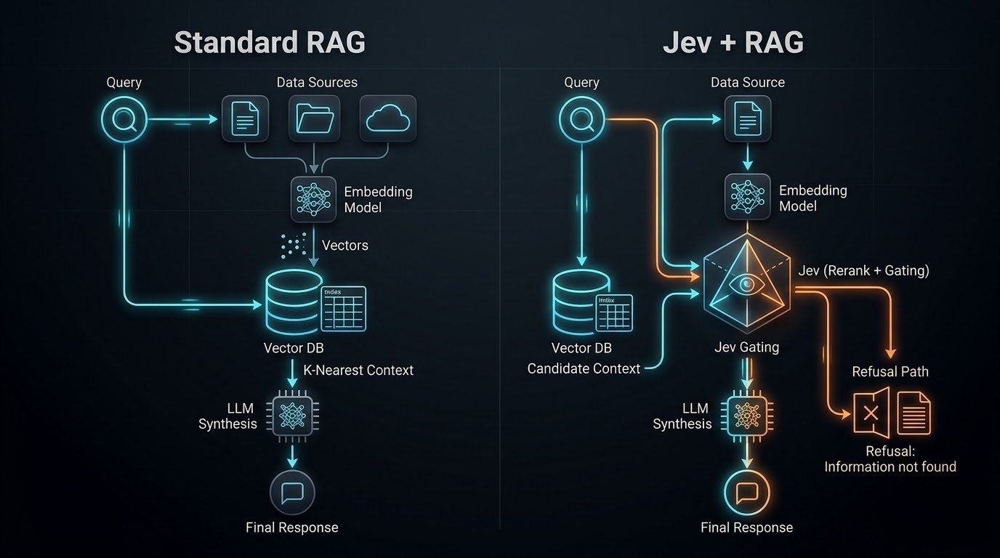

# Titan Annual Report RAG Pipeline (with Jev Gating)

An evaluation-oriented and production-grade Retrieval-Augmented Generation (RAG) pipeline engineered for answering questions from the **Titan Company Limited Integrated Annual Report 2025–26**.

This repository implements two core architectural approaches for processing complex financial queries:

1. **Standard RAG (`rag_pipeline.py`):** Hybrid retrieval (Dense FAISS + Sparse BM25 + Reciprocal Rank Fusion), table structure extraction, entity-metric-fiscal-year grounding, deterministic numerical reasoning engines, and post-generation numeric validation.
2. **Jev + RAG (`rag_pipeline_jev.py`):** An advanced variation incorporating **Jev Reranking & Dynamic Relevance Gating**. Retrieved candidate passages are evaluated by TypeSafe's Jev model; passages below `jev_threshold` are filtered out prior to LLM synthesis, preventing hallucination and enabling dual-layer refusal.

> 📦 **Repository:** [github.com/DwaipayanDutta/RAG-Pipeline-Hackathon](https://github.com/DwaipayanDutta/RAG-Pipeline-Hackathon)

---

## 🏗️ Architecture: Standard RAG vs. Jev + RAG

Below is the architectural workflow comparing standard RAG against the enhanced **Jev + RAG** pipeline with relevance-based gating and abstention layers:



```text
Titan annual report PDF
        |
        v
PDF extraction with pdfplumber & table normalization
        |
        v
Structure-aware page and paragraph chunks + metadata enrichment
        |
        +--> Sentence Transformer embeddings (FAISS index)
        |
        +--> BM25 lexical index
        |
        v
Hybrid retrieval + Reciprocal Rank Fusion (RRF)
        |
        v
  [Optional Jev Gate / Reranker]
        |
        +---> Below threshold? ---> Refuse: "I don't know from the document."
        |
        v (Kept candidates)
Evidence context and question
        |
        v
Reasoning Engine / Grounded Generation (FLAN-T5)
        |
        v
Grounding validation & numeric verification
        |
        v
results.json with answers, confidence, citations, and evidence
```

### Pipeline Comparison

| Component / Feature | Standard RAG (`rag_pipeline.py`) | Jev + RAG (`rag_pipeline_jev.py`) |
| :--- | :--- | :--- |
| **Retrieval Strategy** | Dense (FAISS) + Sparse (BM25) fused via RRF | Dense (FAISS) + Sparse (BM25) fused via RRF |
| **Candidate Gating** | Cross-Encoder Reranking (Top-K) | Jev Reranking & Dynamic Relevance Gating |
| **Noise Filtering** | Passages passed directly to LLM | Drops passages below threshold (`--jev-threshold`) |
| **Abstention Mechanism** | Grounding validation post-LLM | Dual-layer: Jev gate abstention + Grounding validation |
| **Hallucination Rate** | Low (bounded by context) | Ultra-low (unsupported queries gated early) |

---

## 🎯 Problem Statement

The pipeline answers a fixed set of questions about Titan's FY2025–26 annual report. The evaluation set covers several common RAG challenges:

| Question type | Example capability |
| :--- | :--- |
| **Semantic and causal** | Explain what drove Jewellery Division growth |
| **Financial tables** | Extract KPIs for FY2025–26 and FY2024–25 |
| **Numerical filtering** | Identify businesses with double-digit growth |
| **Threshold comparisons** | Find businesses above INR 5,000 crore |
| **Cross-section reasoning** | Combine evidence from multiple report sections |
| **Strategy retrieval** | Find initiatives and programmes |
| **Out-of-document handling** | Refuse unsupported FY2027 questions |

When the report does not provide sufficient evidence or fails grounding checks, the expected response is:

```text
I don't know from the document.
```

---

## 🚀 Key Features & Capabilities

1. **Hybrid Retrieval with Reciprocal Rank Fusion (RRF):**
   - **Dense Retrieval:** FAISS vector index using `sentence-transformers/all-MiniLM-L6-v2` embeddings.
   - **Sparse Retrieval:** BM25Okapi keyword index for high-precision search on financial codes, names, and exact metrics.
   - **Rank Fusion:** Blends dense and sparse retrieval ranks without score calibration mismatch.

2. **Jev Reranking & Dynamic Relevance Gating (`--use-jev`):**
   - Integrates TypeSafe's Jev model to evaluate candidate relevance scores.
   - Filters out irrelevant context using a configurable threshold (`--jev-threshold`, default `0.2`), preventing noisy inputs from reaching the generator.
   - Gracefully degrades to standard RAG if the `jev-reranker` package or API key is unavailable.

3. **Structured Table Extraction & Header-Aware Mapping:**
   - Extracts multi-row, multi-column tables using `pdfplumber`.
   - Maps table headers dynamically to fiscal years (e.g., `FY2025-26`) and metrics (e.g., `revenue`, `profit_before_tax`).

4. **Deterministic Numerical Reasoning Engines:**
   - Bypasses LLM math limitations for high-precision financial operations:
     - **Threshold Engine:** Filters entities meeting condition criteria (e.g., *exceeding 5000 crore*, *double-digit growth*).
     - **Comparison Engine:** Calculates absolute and percentage YoY deltas across fiscal years.
     - **Ranking Engine:** Sorts entities highest/lowest for given financial metrics.
     - **Aggregation Engine:** Computes sum, average, max, and min values.

5. **Multi-Layer Refusal & Grounding Validation:**
   - Verifies all numerical claims, metrics, entities, and fiscal years against extracted evidence records.
   - Enforces strict abstention (`"I don't know from the document."`) if claims cannot be textually or mathematically grounded.

---

## 📁 Project Structure

```text
Titan-RAG/
├── rag_pipeline.py          # Core production-grade RAG pipeline (Standard RAG)
├── rag_pipeline_jev.py      # Extended pipeline with Jev reranking and gating
├── test_rag_pipeline_jev.py # Unit and integration tests for Jev gating logic
├── requirements.txt         # Core Python dependencies
├── image.jpeg               # Architectural comparison diagram
├── queries.json             # Fixed evaluation query set
├── results.json             # Execution and benchmark output
└── README.md                # Project documentation
```

*(Note: The `approach 2` directory is deprecated and excluded from this pipeline implementation.)*

---

## 🛠️ Requirements & Setup

### Requirements
- Python 3.9 or newer
- Titan Annual Report PDF (`Titan_AR_2026.pdf`)
- Disk space for cached index files (`index_cache/`) and transformer model weights

### 1. Clone the repository
```bash
git clone https://github.com/DwaipayanDutta/RAG-Pipeline-Hackathon.git
cd RAG-Pipeline-Hackathon
```

### 2. Install dependencies
```bash
pip install -r requirements.txt
```

### 3. Configure Jev (Optional)
The Jev gating feature requires a TypeSafe API key and the `jev-reranker` package:

```bash
pip install jev-reranker
export TYPESAFE_API_KEY="your-api-key-here"
```

> ⚠️ If the package or API key is missing, `rag_pipeline_jev.py` logs a warning and automatically falls back to the standard RAG path — the pipeline will still work seamlessly without Jev.

---

## 💡 Running the Pipeline

### Standard RAG Pipeline
Run with default inputs or pass custom query strings:

```bash
python3 rag_pipeline.py --pdf Titan_AR_2026.pdf --query "What was Titan's total revenue in FY2025-26?"
```

### Jev-Augmented RAG Pipeline
Enable Jev reranking and gating with custom relevance thresholds:

```bash
python3 rag_pipeline_jev.py \
  --pdf Titan_AR_2026.pdf \
  --use-jev \
  --jev-threshold 0.2 \
  --query "Which business segments achieved double-digit growth?"
```

### Batch Evaluation
Process a full question set and export structured results:

```bash
python3 rag_pipeline_jev.py \
  --pdf Titan_AR_2026.pdf \
  --queries queries.json \
  --output results.json \
  --use-jev
```

### Rebuild Retrieval Index
Force index re-indexing when updating the document:

```bash
python3 rag_pipeline.py --rebuild-index
```

### Running the Test Suite
Verify pipeline functionality and Jev gating behavior:

```bash
python3 -m unittest test_rag_pipeline_jev.py -v
```

---

## ⚙️ Configuration & CLI Reference

| Flag / Parameter | Default | Purpose |
| :--- | :--- | :--- |
| `--pdf` | `Titan_AR_2026.pdf` | Path to the annual report PDF |
| `--query` | `None` | Single query string to evaluate |
| `--queries` | `None` | Path to JSON file with a list of queries |
| `--output` | `stdout` | Path to write output JSON results |
| `--config` | `None` | Path to a JSON configuration override file |
| `--rebuild-index` | `False` | Force rebuild of FAISS and BM25 index caches |
| `--use-jev` | `False` | Enable Jev reranking & gating (`rag_pipeline_jev.py`) |
| `--jev-threshold` | `0.2` | Relevance threshold for Jev gating (0.0 to 1.0) |
| `chunk_size` | `400` | Text chunk size in words |
| `chunk_overlap` | `80` | Word overlap between text chunks |
| `dense_top_k` | `20` | Number of dense candidates retrieved |
| `bm25_top_k` | `20` | Number of lexical candidates retrieved |
| `final_top_k` | `5` | Number of context chunks supplied for generation |

---

## 📊 Output Format

The pipeline outputs structured JSON containing grounded answers, confidence scores, citations, and execution validation:

```json
[
  {
    "query": "What was Titan's total revenue in FY2025-26?",
    "query_type": "NUMERIC",
    "answer": "Titan's total revenue was 51,084 INR crore in FY2025-26.",
    "grounded": true,
    "grounding_status": "grounded",
    "confidence": 1.0,
    "citations": [
      {
        "page": 33,
        "chunk_id": 42
      }
    ],
    "retrieved_chunks": [
      {
        "chunk_id": 42,
        "page": 33,
        "source_type": "table",
        "score": 0.0
      }
    ],
    "validation": {
      "numeric_grounding": true,
      "entity_grounding": true,
      "metric_grounding": true,
      "fiscal_year_grounding": true
    },
    "refusal_reason": null,
    "jev_scores": [
      {
        "chunk_id": 42,
        "score": 0.94,
        "index": 0
      }
    ]
  }
]
```

---

## 🧪 Testing

`test_rag_pipeline_jev.py` covers key pipeline components:

1. **Configuration tests:** Verifies `use_jev`, `jev_threshold`, and `jev_api_key_env` CLI/config handling.
2. **Jev gating unit tests:** Mocks `JevReranker.relevance_rerank` to verify relevant chunks pass, low-relevance chunks are filtered out, and graceful fallback occurs if Jev is unavailable.
3. **End-to-end integration tests:** Mocks PDF ingestion and LLM generation to ensure `QueryResult.jev_scores` propagate and the pipeline safely abstains (`"I don't know from the document."`) if Jev gates all candidates.

---

## 🔍 Identified Gaps & Development Roadmap

### Known Limitations & Gaps
1. **API Fallback & Resilience:** Exception handling currently falls back to standard RAG if the Jev service is unreachable. Asynchronous retries with exponential backoff should be added.
2. **Complex Multi-Page Tables:** While standard multi-header grids are normalized, multi-page nested tables with irregular row spans and inline footnotes require further structural parsing.
3. **Multi-Document Scaling:** Current indexing is optimized for single annual reports per run. Cross-company multi-year benchmarking requires scaling vector store schemas.
4. **Evaluation Harness:** Automated benchmarks against golden QA datasets (e.g., FinQA, TAT-QA) can further track precision/recall regressions over time.

### Development Roadmap
- [x] **Phase 1: Baseline** (PDF extraction, text/table chunking, MiniLM embeddings, FAISS retrieval, FLAN-T5 generation, basic validation)
- [x] **Phase 2: Hybrid Retrieval & Gating** (Full SHA-256 caching, BM25 + FAISS RRF, Jev dynamic gating, query-type routing)
- [x] **Phase 3: Financial Reasoning Engines** (Threshold, YoY comparison, ranking, and aggregation engines)
- [x] **Phase 4: Multi-Layer Grounding & Refusal** (Evidence record mapping, dimension validation, explicit abstention)
- [ ] **Phase 5: Automated Evaluation Harness** (Golden QA scoring, retrieval metrics: Recall@K, MRR, nDCG)
- [ ] **Phase 6: Multi-Document Productionization** (Async API layer, multi-filing vector stores, observability)

---

## 💡 Engineering Philosophy

This project avoids adding heavy framework abstractions (e.g., LangChain, LangGraph, MCP) without demonstrated need. For complex financial reports, the highest-value engineering improvements are:

```text
retrieval recall
→ rank precision & gating
→ numerical reasoning engines
→ claim grounding validation
→ reproducible evaluation
```

---

## 📜 License

Distributed under the MIT License.

## 👤 Author

**Dwaipayan Dutta**  
[GitHub Repository](https://github.com/DwaipayanDutta/RAG-Pipeline-Hackathon)