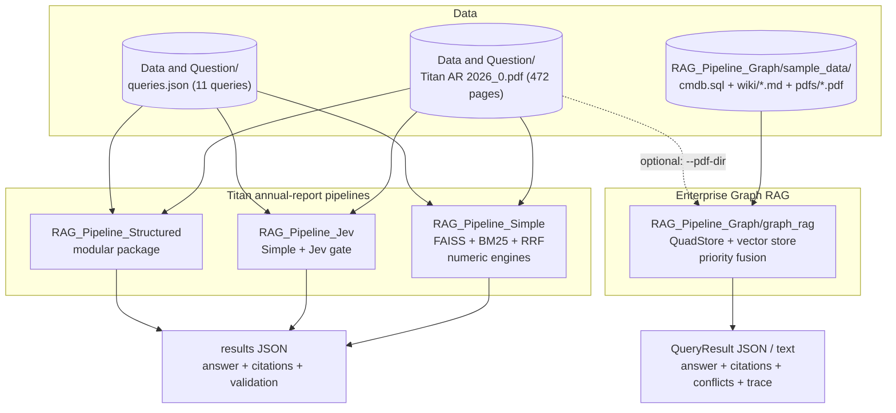
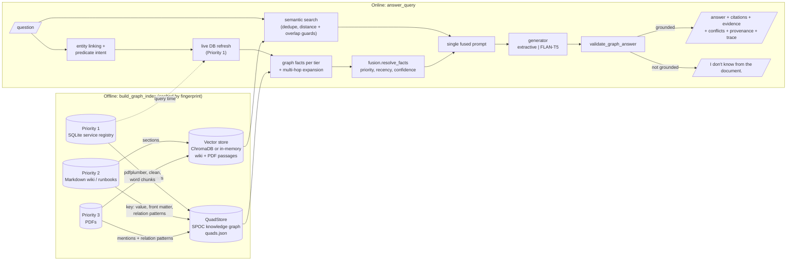

# RAG Pipeline Hackathon: Graph RAG and Titan Annual-Report RAG

This repository contains four retrieval-augmented generation (RAG) pipelines, written in pure Python and runnable locally:

| Pipeline | Folder | Corpus | Retrieval idea |
|---|---|---|---|
| **Graph RAG** (primary) | [`RAG_Pipeline_Graph/`](RAG_Pipeline_Graph/) | Live service database + wiki/runbooks + PDFs | Knowledge graph (SPOC quads) + vector store, fused by **source-priority rules** with explicit conflict resolution |
| Standard RAG | [`RAG_Pipeline_Simple/`](RAG_Pipeline_Simple/) | Titan Company Annual Report 2025-26 (PDF) | FAISS + BM25 + Reciprocal Rank Fusion, numeric reasoning engines, grounding validation |
| Jev + RAG | [`RAG_Pipeline_Jev/`](RAG_Pipeline_Jev/) | Titan annual report | Standard RAG + optional TypeSafe Jev relevance gate |
| Structured RAG | [`RAG_Pipeline_Structured/`](RAG_Pipeline_Structured/) | Titan annual report | The same task split into a modular Python package |

> Repository: [github.com/DwaipayanDutta/RAG-Pipeline-Hackathon](https://github.com/DwaipayanDutta/RAG-Pipeline-Hackathon)
> Graph RAG design inspired by [*Graph RAG for Enterprise Documents: Building a Knowledge Graph from PDFs, Wikis and Databases*](https://machinelearningmastery.com/graph-rag-for-enterprise-documents-building-a-knowledge-graph-from-pdfs-wikis-and-databases/) (MachineLearningMastery).

---

## Table of contents

1. [Overview](#1-overview)
2. [Architecture](#2-architecture)
3. [Repository structure](#3-repository-structure)
4. [Component documentation](#4-component-documentation)
5. [Data flow](#5-data-flow)
6. [Getting started](#6-getting-started)
7. [Configuration reference](#7-configuration-reference)
8. [CLI, Python API and scripts](#8-cli-python-api-and-scripts)
9. [Testing](#9-testing)
10. [Development guide](#10-development-guide)
11. [Troubleshooting](#11-troubleshooting)
12. [Limitations and roadmap](#12-limitations-and-roadmap)
13. [References and credits](#13-references-and-credits)

---

## 1. Overview

### The problem

Enterprise knowledge is spread over sources that differ in how much you can trust them:

- A **live structured database** (service registry / CMDB) holds the current facts: service owner, on-call engineer, deployment status, version, environment, SLA tier.
- **Wikis and runbooks** hold operational know-how, but they go stale. The wiki may still name last year's on-call engineer.
- **PDF documents** (post-mortems, architecture reviews) carry narrative context. They are the oldest and least precise source of facts.

Plain vector-similarity RAG treats all of these the same. If a stale wiki page is the closest match, the system repeats the stale fact. The **Graph RAG pipeline** answers from all three sources but enforces an explicit order:

```text
Priority 1  live database facts      always win
Priority 2  wiki / runbook facts      used when the database is silent
Priority 3  PDF / vector-store text   supporting narrative and last-resort facts
```

When sources disagree, the conflict is **detected, resolved and reported**, never silently dropped. The response says which source won and why.

### Main capabilities (Graph RAG)

- Ingestion from **SQLite** (a `.sqlite` file, or a `.sql` seed script), **Markdown wikis** (key/value lines, front matter, prose relation patterns, runbook sections) and **PDFs** (pdfplumber, cleaning, word-based chunking with overlap).
- A **knowledge graph** of Subject-Predicate-Object-Context quads. Each quad records its source tier, source file, timestamp, confidence and an evidence sentence. The graph supports entity lookup and **multi-hop traversal**, for example service → owning team → manager.
- A **vector store** (ChromaDB, or a built-in in-memory store) over PDF chunks and wiki/runbook sections, with page and section metadata.
- **Retrieval fusion with conflict resolution:** tier priority, then newest timestamp, then confidence. Each conflict is reported with a reason.
- **Live Priority-1 refresh:** database rows are re-read at query time, so answers follow the database without rebuilding the index.
- **Grounded answers** with citations, evidence, a provenance explanation and a retrieval trace. There are two generators:
  - a deterministic **extractive** generator, used by default; it works offline and cannot fabricate;
  - **FLAN-T5**, which runs a single fused prompt.

  A validator rejects stale, hallucinated or off-topic answers. When evidence is missing, the answer is `I don't know from the document.`
- Runs fully offline with fallbacks: hash embeddings, the in-memory vector store and the extractive generator. No API key is required.

### Intended users

- Hackathon participants and engineers who want a small, readable reference implementation of three-tier Graph RAG.
- People evaluating RAG strategies on a financial PDF. The three Titan pipelines answer the challenge in [`Data and Question/Titan_RAG_Coding_Challenge.txt`](Data%20and%20Question/Titan_RAG_Coding_Challenge.txt).

### How Graph RAG fits in

The Titan pipelines solve *one PDF → grounded answers*. The Graph pipeline adds a deterministic **knowledge graph** for facts and keeps the vector store for narrative text. Facts get exact, explainable answers. Explanations ("why was the deploy rolled back?") still come from semantic search. The two kinds of evidence meet in one fused, priority-ordered context.

---

## 2. Architecture

### 2.1 The whole repository



### 2.2 Graph RAG pipeline



### 2.3 Three-tier priority model

| Tier | Source | Stored as | Quad `context` | Confidence | Role |
|---|---|---|---|---|---|
| **Priority 1** | SQLite service registry (`services`, `teams`, `service_dependencies`) | SPOC quads | `cmdb` | 1.0 | Authoritative, current facts. Refreshed live at query time. |
| **Priority 2** | Markdown wiki pages and runbooks | SPOC quads + vector passages | `wiki` | 0.9 (key/value), 0.7 (prose pattern), 0.5 (LLM-extracted) | Supplementary facts and procedures; may be stale |
| **Priority 3** | PDF documents | Vector chunks + low-confidence quads | `pdf` | 0.6 (relation), 0.4 (mention) | Narrative context; last-resort facts |

### 2.4 Conflict resolution rules

Conflict resolution is implemented in [`graph_rag/fusion.py`](RAG_Pipeline_Graph/graph_rag/fusion.py). It runs for every `(subject, predicate)` pair retrieved for a question:

1. **Single-valued predicates** (`owner_team`, `on_call_engineer`, `status`, `version`, `environment`, `sla_tier`, `manager`, … see `single_valued_predicates`). Candidates are ranked by
   **tier priority** (cmdb > wiki > pdf) → **newer timestamp** → **higher confidence**.
   The top candidate wins. Every source that states a *different* value is recorded as **overridden**, with a reason such as `Priority 1 outranks Priority 2` or `same tier, newer timestamp wins`. Sources that state the same value are recorded as **corroborating**.
2. **Multi-valued predicates** (`depends_on`, `member`, …) are unioned. Each value is attributed to its most authoritative source.
3. `mentioned_in` quads (a PDF page mentions an entity) are evidence pointers, never claims.

Priority is then enforced in three places:

- **In the prompt.** The fused prompt contains the `PRIORITY_RULES`, all facts grouped by tier, a `RESOLVED CONFLICTS` section and the `KEY FACTS FOR THIS QUESTION` (already resolved).
- **In generation.** The extractive generator only ever states *resolved winners*.
- **After generation.** `validate_graph_answer` rejects any answer that states an overridden value (`no_priority_conflict`), names something not in the evidence (`entity_grounding`), is mostly unsupported text (`token_coverage`), or answers a different attribute than the one asked (`answers_question`).

Every result lists **all** conflicts found for the question's entities. Entries with `affects_answer: true` are the ones that changed this answer.

---

## 3. Repository structure

### 3.1 Directory tree

```text
RAG-Pipeline-Hackathon/
├── README.md                         # this file
├── requirements.txt                  # installs every pipeline's dependencies (-r includes)
├── .env.example                      # optional environment variables (no secrets required)
├── .gitignore                        # ignores indexes, caches, .env, results*.json
├── config.json                       # sample --config override for the Titan pipelines (Simple/Jev)
├── image.jpeg                        # diagram: Standard RAG vs Jev + RAG
│
├── Data and Question/                # Titan challenge inputs (note the spaces in the name)
│   ├── Titan AR 2026_0.pdf           # Titan Company Integrated Annual Report 2025-26, 472 pages
│   ├── Titan_RAG_Coding_Challenge.txt# the original challenge brief and evaluation criteria
│   └── queries.json                  # 11 evaluation questions ([{"query": ...}])
│
├── RAG_Pipeline_Graph/               # ★ Graph RAG (primary)
│   ├── rag_pipeline_graph.py         # CLI entry point + backward-compatible module facade
│   ├── config_graph.json             # every setting with its default (relative to this folder)
│   ├── requirements_graph.txt        # self-contained deps (only pdfplumber strictly required)
│   ├── conftest.py                   # puts graph_rag/ and tests/ on sys.path for pytest
│   ├── Verify.sh                     # install → test → build → query → evaluate smoke script
│   ├── graph_rag/                    # the implementation package
│   │   ├── __init__.py               # public API: GraphRAGPipeline, load_config, Quad, ...
│   │   ├── config.py                 # DEFAULT_CONFIG, load_config, env overrides, path resolution
│   │   ├── models.py                 # Quad, Chunk, ResolvedFact, Retrieval, QueryResult, tiers
│   │   ├── text.py                   # cleaning, tokenising, sentence split, hashing helpers
│   │   ├── graph_store.py            # QuadStore: indexes, query, multi-hop traversal, JSON persistence
│   │   ├── sources/
│   │   │   ├── database.py           # Priority 1: DatabaseSource / SQLiteSource, live lookups
│   │   │   ├── wiki.py               # Priority 2: front matter, key/value facts, passages, LLM fallback
│   │   │   ├── pdf.py                # Priority 3: pdfplumber extraction, chunking, PDF facts
│   │   │   └── relations.py          # deterministic relation patterns for prose (wiki + PDF)
│   │   ├── embeddings.py             # sentence-transformers embedder + offline hash embedder
│   │   ├── vector_store.py           # ChromaVectorStore, InMemoryVectorStore, dedupe/guards
│   │   ├── index.py                  # build_graph_index: ingestion + fingerprint cache
│   │   ├── retrieval.py              # entity linking, predicate intents, tiered retrieval
│   │   ├── fusion.py                 # priority rules, conflict detection, provenance text
│   │   ├── prompting.py              # PRIORITY_RULES, fused prompt, token-budget fitting
│   │   ├── generation.py             # ExtractiveGenerator, FlanT5Generator
│   │   ├── validation.py             # post-generation grounding checks
│   │   ├── pipeline.py               # GraphRAGPipeline, answer_query (orchestration)
│   │   ├── evaluation.py             # queries file loader + expected-answer scoring
│   │   ├── demo_data.py              # sample-PDF generator, --seed-demo copier
│   │   └── cli.py                    # argparse CLI
│   ├── sample_data/                  # committed demo corpus (small, diff-able)
│   │   ├── cmdb.sql                  # Priority 1: teams, services, service_dependencies
│   │   ├── wiki/                     # Priority 2: 5 pages (2 deliberately stale)
│   │   ├── pdfs/                     # Priority 3: incident_reports.pdf, architecture_review_2024.pdf
│   │   └── queries_graph.json        # 15 questions with expected answers
│   └── tests/                        # 69 tests (67 run offline; 2 opt-in/optional)
│       ├── conftest.py               # fixtures: seeded temp data, hash embeddings, ScriptedLLM
│       ├── test_graph_store.py       test_database.py      test_wiki.py        test_pdf.py
│       ├── test_vector_store.py      test_fusion.py        test_retrieval.py
│       ├── test_generation_prompting.py                    test_pipeline_e2e.py
│
├── RAG_Pipeline_Simple/              # Standard RAG over the Titan report (single file)
│   ├── rag_pipeline.py               # extraction → chunks → FAISS+BM25+RRF → engines/FLAN-T5 → validation
│   ├── requirements.txt              # deps for Simple (also used by Jev and Structured)
│   └── test_rag_pipeline.py          # 18 unit tests (no model downloads)
│
├── RAG_Pipeline_Jev/                 # Standard RAG + Jev relevance gate (single file)
│   ├── rag_pipeline_jev.py
│   ├── requirements.txt              # -r ../RAG_Pipeline_Simple/requirements.txt + jev-reranker
│   └── test_rag_pipeline_jev.py      # 8 tests (Jev mocked; loads MiniLM once)
│
└── RAG_Pipeline_Structured/          # the Titan task as a Python package
    ├── __init__.py  __main__.py      # `python -m RAG_Pipeline_Structured ...`
    ├── cli.py config.py models.py pipeline.py
    ├── ingestion.py chunking.py indexing.py fingerprint.py
    ├── retrieval.py reranking.py query_router.py prompting.py generation.py
    ├── validation.py numerical.py citations.py evaluation.py observability.py
    ├── conftest.py                   # repo root on sys.path for the package tests
    └── test_chunking.py test_pipeline.py test_retrieval.py   # 12 tests
```

Generated at run time and git-ignored: `RAG_Pipeline_Graph/.graph_index/`, `RAG_Pipeline_Structured/.index/`, `index_cache/` (in the working directory, created by Simple and Jev), `results*.json`, `__pycache__/`.

### 3.2 Folder reference

| Folder | Purpose | Key files | When to modify |
|---|---|---|---|
| `RAG_Pipeline_Graph/` | Three-tier enterprise Graph RAG: DB > wiki > PDF with conflict resolution | `graph_rag/` package, `rag_pipeline_graph.py`, `config_graph.json` | Changing ingestion, graph schema, retrieval, priority rules, prompts or generation |
| `RAG_Pipeline_Graph/graph_rag/sources/` | One ingester per source tier + shared prose relation patterns | `database.py`, `wiki.py`, `pdf.py`, `relations.py` | Adding a data source or a new fact pattern |
| `RAG_Pipeline_Graph/sample_data/` | Small committed corpus that demonstrates stale-wiki and stale-PDF conflicts | `cmdb.sql`, `wiki/*.md`, `pdfs/*.pdf`, `queries_graph.json` | Adding demo scenarios or evaluation questions |
| `RAG_Pipeline_Graph/tests/` | Per-component and end-to-end tests, offline by default | `conftest.py`, `test_*.py` | With every behaviour change in `graph_rag/` |
| `RAG_Pipeline_Simple/` | Reference Titan pipeline: hybrid retrieval, table parsing, deterministic numeric engines, grounding validation | `rag_pipeline.py` | Changing Titan retrieval, numeric reasoning or validation |
| `RAG_Pipeline_Jev/` | Simple pipeline + optional Jev rerank/gate before generation | `rag_pipeline_jev.py` | Tuning the Jev gate or its fallback |
| `RAG_Pipeline_Structured/` | Modular package version of the Titan task (dense+BM25+RRF, cross-encoder reranking, FLAN-T5, numeric validation) | `pipeline.py`, `retrieval.py`, `config.py` | Experimenting with a stage in isolation |
| `Data and Question/` | Titan challenge inputs: report PDF, brief, queries | `Titan AR 2026_0.pdf`, `queries.json` | Adding Titan evaluation questions |
| repository root | Shared install file, env template, Titan config sample, diagram | `requirements.txt`, `.env.example`, `config.json`, `image.jpeg` | Cross-pipeline dependencies or settings |

### 3.3 Notable files

- `config.json` (root) contains the same keys and values as `DEFAULT_CONFIG` in `RAG_Pipeline_Simple/rag_pipeline.py`. Pass it with `--config config.json` and edit it to tune Simple/Jev without touching code. The pipelines do **not** load it automatically.
- `image.jpeg` is a conceptual diagram comparing *Standard RAG* (query → vector DB → LLM) with *Jev + RAG* (an extra rerank-and-gate step with a refusal path). It describes the Simple and Jev pipelines.
- `Data and Question/Titan_RAG_Coding_Challenge.txt` is the specification the Titan pipelines target: chunking, embeddings, FAISS, an open-source LLM, a JSON output schema, and the `I don't know from the document.` refusal. The Graph pipeline reuses the refusal string and the core `QueryResult` fields.
- `RAG_Pipeline_Graph/rag_pipeline_graph.py` re-exports the names of the original single-file implementation (`Quad`, `QuadStore`, `build_index`, `answer_query`, `seed_demo_data`, …). Older code that did `import rag_pipeline_graph as g` keeps working.

---

## 4. Component documentation

All Graph RAG components live in `RAG_Pipeline_Graph/graph_rag/`. Heavy libraries (chromadb, sentence-transformers, transformers, torch, spaCy, pdfplumber) are imported lazily, so the package imports and most tests run without them.

### 4.1 Configuration (`config.py`)

- **What it does:** builds the effective settings dictionary.
- **Inputs:** `DEFAULT_CONFIG`, then an optional JSON file, then `RAG_GRAPH_*` environment variables, then keyword overrides from the CLI. Each layer overrides the previous one.
- **Path resolution:** default paths are resolved relative to `RAG_Pipeline_Graph/`, config-file paths relative to that file, and environment/CLI paths relative to the current directory. As a result, the pipeline behaves the same from any working directory.
- **Validation:** `validate_config` rejects unknown backends and invalid chunk sizes. A missing `--config` file raises `FileNotFoundError` rather than being ignored silently.
- **Main API:** `load_config(config_path=None, use_env=True, **overrides)`, `DEFAULT_CONFIG`, `PACKAGE_ROOT`, `load_dotenv_if_available()`.

### 4.2 Data model (`models.py`)

| Type | Fields | Notes |
|---|---|---|
| `Quad` | `subject, predicate, object, context, source` + `timestamp, confidence, evidence` | Frozen SPOC fact. `context` is the tier (`cmdb`/`wiki`/`pdf`). Provenance fields are excluded from equality, so the same statement from the same source is stored once. `.priority` gives 1, 2 or 3. |
| `Chunk` | `chunk_id, page, section, source_type, text, metadata` | PDF window (`source_type="text"`) or wiki section (`"wiki"`). Metadata: `tier, source, title, path, timestamp, doc_id, subject`. |
| `ResolvedFact` | `subject, predicate, value, winner, agreeing, overridden, reason` | Output of conflict resolution. |
| `Retrieval` | `entities, predicates, p1, p2, pdf_facts, related, wiki_passages, p3, resolved, conflicts, unknown_entities, trace` | Everything retrieved for one question. |
| `QueryResult` | `query, query_type, answer, grounded, grounding_status, confidence, citations, retrieved_chunks, validation, refusal_reason` + `priority_tier, vector_fallback_used, entities, conflicts, evidence, source_explanation, trace, prompt` | The first ten fields match the Titan pipelines' `QueryResult`. |

### 4.3 Knowledge graph (`graph_store.py`)

`QuadStore` is an in-process graph. Quads are indexed by normalised subject and object, so matching ignores case, hyphens and punctuation: `Payments Service` == `payments-service`.

| Method | Purpose |
|---|---|
| `add`, `add_many` | Insert with de-duplication |
| `query(entities, context=None)` | Facts where an entity is subject **or** object, optionally for one tier |
| `about(subject, predicate=None, context=None)` | Facts *about* a subject |
| `expand_with_hops(seeds, hops, traversal_predicates)` / `expand` | Multi-hop breadth-first traversal. Walks to subjects, and to objects of `traversal_predicates` (people, teams, services). Never walks into literal values such as `degraded`. Each fact is tagged with the hop at which it was reached. |
| `node_names()` | Subjects plus node-like objects; used for entity linking |
| `replace_subject_facts(subject, context, quads)` | Swap one subject's facts for one tier (used by live refresh) |
| `save(path)` / `load(path)` | JSON persistence (`quads.json`) |
| `stats()` | Counts by tier and predicate |

**Graph schema (predicates in the sample data):**

| Predicate | Example | Kind |
|---|---|---|
| `type` | `payments-service type service` | single |
| `owner_team` | `payments-service → Payments Platform` | single, traversable |
| `on_call_engineer` | `payments-service → Amara Chen` | single, traversable |
| `status`, `version`, `environment`, `sla_tier`, `last_deployed_at` | `payments-service status degraded` | single, literal |
| `depends_on` | `payments-service → ledger-service` | multi, traversable |
| `manager`, `slack_channel` | `Payments Platform → Priya Nair` | single |
| `escalation_contact`, `tier` | from wiki pages | single |
| `member` | `Payments Platform → Amara Chen` | multi, traversable |
| `mentioned_in` | `payments-service → incident_reports.pdf p.1` | evidence pointer |

Database columns and wiki keys become predicates automatically, after normalisation and the aliases in `wiki.KEY_ALIASES`. For example, `Owner`, `team` and `owned_by` all map to `owner_team`.

### 4.4 Priority 1: database ingestion (`sources/database.py`)

- **Input:** `db_path` can be a `.sqlite`/`.db` file (opened **read-only**), a `sqlite:///path` URL, or a `.sql` script. A script is executed into a fresh in-memory SQLite database on every read, so the committed `sample_data/cmdb.sql` stays human-readable and diff-able.
- **Table specs (`db_tables`):**
  - *Entity table*: `{"table", "key_column", "entity_type"?, "timestamp_column"?}`. Produces one quad per non-null column. The timestamp column becomes quad metadata rather than a fact.
  - *Edge table*: `{"table", "key_column", "edge_predicate", "object_column"}`. Produces one relationship per row.
  - Legacy single-table form: `db_table` + `db_key_column`.
- **Live lookups:** `facts_for(source, specs, subjects)` re-reads rows for specific subjects using parameterised `IN (...)` queries. Retrieval calls it for the question's entities when `live_db_refresh` is true.
- **Safety:** table and column names are validated against `[A-Za-z_][A-Za-z0-9_]*`. Values are always bound parameters.
- **Extension point:** `DatabaseSource` (abstract `connect()`, `placeholder`). A `postgresql://` URL raises `NotImplementedError` with instructions (see §10.7).

### 4.5 Priority 2: wiki and runbook ingestion (`sources/wiki.py`, `sources/relations.py`)

Facts are extracted from each `*.md` page in this order:

1. **Front matter** (`---` block): `entity` (the graph subject; defaults to the file name stem), `last_updated` (quad timestamp), `title`.
2. **Key/value lines**: `Key: value`, `- Key: value` and `**Key:** value`. URL lines are skipped. List keys (`Depends on`, `Members`) are split on commas and "and". Confidence is 0.9.
3. If a page has no key/value lines: **relation patterns** over the prose, anchored on known graph entities (confidence 0.7). Supported forms:
   - `X is owned by the Y team`
   - `Y owns X`
   - `X depends on a, b and c`
   - `Name is the on-call engineer for X`
   - `the on-call engineer for X was Name`
   - `Y team is managed by Name`
4. If still nothing matches and `use_llm_wiki_extraction` is true: FLAN-T5 triple extraction (confidence 0.5).

In addition, every heading-delimited section, minus its key/value lines, becomes a **passage** in the vector store. This is how runbook procedures such as "how do I roll back a deploy?" become answerable.

### 4.6 Priority 3: PDF ingestion, chunking and embedding (`sources/pdf.py`, `embeddings.py`)

- **Extraction:** pdfplumber, page by page. A malformed page logs a warning and yields empty text. A PDF with no extractable text is reported as probably scanned (OCR is not implemented).
- **Cleaning (`text.clean_text`):**
  - removes `(cid:N)` glyph markers;
  - re-joins typographic hyphenation (`connec-⏎tion`) but keeps real hyphenated identifiers (`payments-⏎service` → `payments-service`);
  - collapses whitespace while keeping paragraph breaks.
- **Chunking:** fixed-size **word** windows (`chunk_size=120`, `chunk_overlap=30`) that pack paragraphs. Chunks never span pages, so every chunk has exactly one page reference.
- **Metadata per chunk:** `tier, source, title` (from PDF metadata or the first line), `doc_id, path, page, chunk_id`, and `timestamp` (the first `YYYY-MM-DD` date in the document).
- **PDF facts:** `mentioned_in` quads for known entities, plus relation-pattern facts (confidence 0.6). These let the fusion layer detect PDF-vs-database conflicts, for example a 2024 review naming a different owner.
- **Embeddings:**
  - `SentenceTransformerEmbedder` uses `all-MiniLM-L6-v2`, normalised.
  - `HashEmbedder` is a deterministic hashed bag of stemmed words and bigrams: no download, lexical rather than semantic.
  - With `embedding_backend="auto"`, the sentence-transformers embedder is tried first, with a fallback to hash.

### 4.7 Vector store (`vector_store.py`)

| Backend | When | Persistence |
|---|---|---|
| `ChromaVectorStore` | `vector_backend=chroma`, or `auto` with chromadb installed | `.graph_index/chroma/` (cosine HNSW) |
| `InMemoryVectorStore` | `memory`, or `auto` without chromadb | `.graph_index/vectors.json` |

Both compute embeddings themselves and pass vectors explicitly, so they do not depend on ChromaDB's embedding-function API, which changes between versions.

`search(query, k, max_distance, tiers, min_overlap, dedupe_jaccard)` post-processes every hit:

- drops hits beyond `vector_max_distance`;
- drops passages that share fewer than `min_passage_overlap` content words with the query (this stops "closest but irrelevant" chunks);
- removes near-duplicates whose Jaccard similarity is at least `dedupe_jaccard`.

Each hit returns `text, tier, source, title, section, page, chunk_id, path, timestamp, distance, score`.

### 4.8 Index building and caching (`index.py`)

`build_graph_index(config, rebuild=False, embedding_fn=None)` runs, in order:

1. database → quads
2. wiki → quads + passages
3. PDFs → chunks + quads
4. vector store
5. save `quads.json` + `meta.json`

It returns a `GraphIndex(store, vstore, db, db_specs, from_cache, stats)`. The cache is reused when the **fingerprint** matches. The fingerprint is a SHA-256 over:

- every source file's content;
- the index-affecting settings: chunking, `db_tables`, extraction flags, `known_entities`;
- the embedder name, the resolved vector backend and the schema version.

`build_index(...)` is the older wrapper that returns `(store, vstore)`.

### 4.9 Retrieval orchestration (`retrieval.py`)

1. **Entity linking:** case-, hyphen- and punctuation-insensitive matching of graph node names and `known_entities`, with the longest match winning. spaCy NER is added when `en_core_web_sm` is installed.
2. **Predicate intent:** keyword intents (`on call` → `on_call_engineer`, `owns` → `owner_team`, `manages` → `manager`, `depend` → `depends_on`, `version`, `status`, `slack`, `escalation`, …). A generic rule adds any predicate whose words all appear in the question.
3. **Unknown identifiers:** hyphenated ids in the question that are not in the graph, such as `inventory-service`, are recorded. Passages must then mention them literally, so the system refuses instead of guessing.
4. **Live refresh** of Priority-1 facts for the linked entities (`trace.live_refresh`).
5. **Graph facts per tier** (`p1`, `p2`, `pdf_facts`), asked predicates first, `graph_top_k` per tier.
6. **Multi-hop expansion** (`graph_hops`, `traversal_predicates`), recorded in `trace.hops`.
7. **Semantic search** over wiki passages and PDF chunks.
8. **Fusion:** `resolve_facts` over all retrieved facts (§2.4).

`relevant_facts(r)` selects the resolved facts that answer the question, including multi-hop follow-ups.

### 4.10 Prompt templates (`prompting.py`)

`build_system_prompt` assembles the **single fused prompt** used for generation:

```text
PRIORITY_RULES (Priority 1 absolute, 2 supplementary, 3 last resort, refusal sentence)
=== PRIORITY 1: LIVE DATABASE FACTS ===          (cmdb) payments-service on_call_engineer: Amara Chen.
=== PRIORITY 2: WIKI FACTS (may be stale) ===    (wiki) payments-service on_call_engineer: Jordan Blake.
=== PRIORITY 2: WIKI / RUNBOOK PASSAGES ===      [payments-service.md Runbook: ...] ...
=== RELATED GRAPH FACTS ===                      (multi-hop facts)
=== PRIORITY 3: FACTS EXTRACTED FROM PDFS ===
=== PRIORITY 3: PDF NARRATIVE CONTEXT ===        [incident_reports.pdf p.1] ...
=== RESOLVED CONFLICTS ===                       payments-service on_call_engineer: use 'Amara Chen' (cmdb); ignore 'Jordan Blake' (wiki), ...
=== KEY FACTS FOR THIS QUESTION (conflicts already resolved) ===
=== QUESTION ===
```

`fit_prompt` keeps the prompt within `max_context_tokens + 200` tokens. It measures with the generator's real tokenizer when one is available, otherwise with a conservative chars/3 estimate. It drops the lowest-priority material first, in this order: related facts, PDF passages, PDF facts, wiki passages, wiki facts. **Priority-1 facts, resolved conflicts and key facts are never dropped**, and the question always survives.

### 4.11 Answer generation (`generation.py`)

| Backend | `llm_backend` | Behaviour |
|---|---|---|
| `ExtractiveGenerator` | `extractive` (default) | Deterministic, offline, no model. For fact questions it states only *resolved winners*, using templates: forward ("The on-call engineer for X is Y."), reverse ("Y is the on-call engineer for A and B."), dependency direction ("A depends on B.") and multi-hop ("The manager for Payments Platform is Priya Nair."). For "how/why" questions it quotes the best runbook section or the best sentence pair from **one** passage. If neither route has evidence, it refuses. |
| `FlanT5Generator` | `flan-t5` | `google/flan-t5-base` (configurable) over the fused prompt. Loaded once and cached. Uses the exact tokenizer for prompt fitting. |

Any object with `generate(prompt) -> str` can be passed as a generator, for example a test double or another LLM wrapper. Its free-text output is attributed to the facts and passages it actually states.

### 4.12 Validation (`validation.py`)

`validate_graph_answer(answer, retrieval, min_coverage)` returns `(grounded, checks, reason)`:

| Check | Fails when |
|---|---|
| `no_priority_conflict` | The answer states an overridden value and not the winning one, e.g. "Jordan Blake" |
| `answers_question` | The graph has a value for the asked attribute but the answer contains none of them, e.g. "Web Commerce" to a *version* question |
| `entity_grounding` | A multi-word name, hyphenated id or standalone number in the answer is not in the evidence |
| `token_coverage` | Less than `grounding_min_coverage` of the answer's content words appear in the evidence |

Any failure turns the answer into `I don't know from the document.` and records the reason in `refusal_reason`.

### 4.13 Pipeline, provenance and evaluation (`pipeline.py`, `evaluation.py`)

`GraphRAGPipeline(config).build().ask(question)` returns a `QueryResult` with:

- `answer`;
- `citations`: numbered; facts carry `tier`/`priority`/`source`/`timestamp`, passages carry `source`/`title`/`page` or `section`;
- `evidence`: each fact with its resolution reason, and each passage;
- `conflicts`, each with `affects_answer`;
- `source_explanation`;
- `priority_tier`, the best tier used, with confidence 1.0, 0.6 or 0.3;
- `trace`: entities, predicates, live refresh, hops, counts and timings.

`evaluation.evaluate(pipeline, items)` scores a queries file whose items carry `expected` substrings or `"REFUSAL"`, plus optional `expect_conflict` and `expect_tier`.

### 4.14 Sample data (`sample_data/`, `demo_data.py`)

The sample data is a fictional payments platform, built so that every conflict type occurs:

| Fact | Priority 1 (DB) | Priority 2 (wiki) | Priority 3 (PDF) |
|---|---|---|---|
| on-call for payments-service | **Amara Chen** | Jordan Blake (page dated 2025-01-10) | Jordan Blake (2024 review) |
| status of payments-service | **degraded** | healthy | n/a |
| version of checkout-service | **5.3.0** | 5.2.0 | n/a |
| owner of payments-service | **Payments Platform** | Payments Platform | Core Payments (2024 review) |
| escalation contact | n/a | **Priya Nair** (wiki-only fact) | n/a |

Other sample files:

- `ledger-service.md` is deliberately prose-only, to exercise the relation patterns.
- `incident-response-runbook.md` has no entity facts; it exists for passage questions.
- `demo_data.SAMPLE_PDFS` holds the PDF text. `--generate-sample-pdfs` re-renders the PDFs and needs reportlab.
- `--seed-demo DIR` copies everything to `DIR` with a real `cmdb.sqlite` file.

### 4.15 Titan pipelines (`RAG_Pipeline_Simple/`, `RAG_Pipeline_Jev/`, `RAG_Pipeline_Structured/`)

**Standard RAG (`rag_pipeline.py`):**

- pdfplumber text and table extraction, with header-aware table normalisation (fiscal-year and metric mapping);
- paragraph chunks plus one chunk per table row;
- entity, metric and fiscal-year enrichment into `EvidenceRecord`s;
- `all-MiniLM-L6-v2` + FAISS `IndexFlatIP`, with BM25Okapi and RRF fusion, and an optional cross-encoder reranker;
- query routing (`THRESHOLD`/`COMPARISON`/`RANKING`/`AGGREGATION`/`NUMERIC`/`FACTUAL`) to deterministic numeric engines or FLAN-T5;
- validation of numbers, entities, metrics and fiscal years against the evidence records;
- caches its index in `index_dir` (`index_cache/` relative to the working directory).

**Jev + RAG (`rag_pipeline_jev.py`):**

- the same pipeline, with `Retriever.jev_gate` after retrieval;
- passages scoring below `jev_threshold` are dropped, and the query is refused if none survive;
- needs the `jev-reranker` package and `TYPESAFE_API_KEY`; without them it logs a warning and runs as Standard RAG;
- `QueryResult.jev_scores` records the gate scores.

**Structured (`RAG_Pipeline_Structured/`):** a package with one module per stage:

| Module(s) | Stage |
|---|---|
| `ingestion`, `chunking` | Word-window text chunks and table-row chunks |
| `indexing` | FAISS + BM25, fingerprint-keyed cache in `.index/` |
| `retrieval` | Dense + lexical + RRF |
| `reranking` | Cross-encoder; degrades to pass-through if unavailable |
| `prompting`, `generation` | Token-budgeted prompt; FLAN-T5 |
| `validation` | Numeric claim check |
| `citations`, `observability` | Citations; per-stage timings |
| `evaluation`, `cli` | Batch evaluation; command-line interface |

`numerical.filter_by_threshold` is **not implemented**: it raises `NotImplementedError` and points to the Simple pipeline's engine.

---

## 5. Data flow

1. **Raw data enters** as follows. Graph RAG: `db_path`, `wiki_dir` and `pdf_dir`; by default the files in `RAG_Pipeline_Graph/sample_data/`, or whatever `--db/--wiki-dir/--pdf-dir` point to. Titan pipelines: `--pdf`, which defaults to `Data and Question/Titan AR 2026_0.pdf`.
2. **Each source is processed:**
   - DB rows → typed quads, with the row's `updated_at` as timestamp;
   - wiki pages → front-matter-aware facts and section passages;
   - PDFs → cleaned page text → word chunks, plus mention/relation quads.
3. **Metadata retained:**
   - every quad: tier, source (`cmdb.sql:services`, `payments-service.md`, `architecture_review_2024.pdf p.1`), timestamp, confidence, evidence line;
   - every passage: tier, file, title, section or page, chunk id, path, document date.
4. **Graph nodes and edges** are the subjects and objects of quads; predicates are edges. Embeddings are computed once per passage at build time and stored with their metadata.
5. **Retrieval** combines graph facts (three tiers plus multi-hop) and semantic passages. `resolve_facts` merges the facts into winners with corroboration and overrides.
6. **The final response** is produced from the single fused prompt (FLAN-T5) or the resolved facts and passages (extractive), then validated.
7. **Provenance** travels from ingestion to output unchanged: citations quote the winning quad's `source` and `timestamp` or the passage's `source`/`page`/`section`. `conflicts` and `evidence[].resolution` explain every override.

---

## 6. Getting started

### 6.1 Prerequisites

- Python **3.9+**. The code avoids newer syntax, but the only version actually tested is Python 3.14 on Windows 11. The CLIs work in Bash, PowerShell or cmd.
- About 1 GB of disk space if you install the full ML stack and download models: MiniLM is about 90 MB, FLAN-T5-base about 1 GB.
- Internet access only for the first model download. After that everything runs offline, and the Graph pipeline can run with no model at all.

### 6.2 Clone and install

```bash
git clone https://github.com/DwaipayanDutta/RAG-Pipeline-Hackathon.git
cd RAG-Pipeline-Hackathon
python -m venv .venv
source .venv/bin/activate            # Windows PowerShell: .venv\Scripts\Activate.ps1

pip install -r requirements.txt      # everything (all four pipelines + tests)
# or just the Graph pipeline:
pip install -r RAG_Pipeline_Graph/requirements_graph.txt
# or the minimal offline Graph install (hash embeddings, in-memory store, extractive answers):
pip install pdfplumber pytest
```

Optional: `python -m spacy download en_core_web_sm` adds spaCy NER for query entities.

### 6.3 Environment variables

None are required. To override settings, copy the template and edit it:

```bash
cp .env.example RAG_Pipeline_Graph/.env   # auto-loaded by the Graph CLI if python-dotenv is installed
```

| Variable | Needed for |
|---|---|
| `TYPESAFE_API_KEY` | Only for the Jev pipeline's `--use-jev` |
| `HF_HOME`, `HF_TOKEN`, `HF_HUB_OFFLINE` | Hugging Face cache location, rate limits, offline mode |
| `RAG_GRAPH_*` | Graph pipeline overrides (see §7.2) |

### 6.4 Graph RAG: build, query, evaluate

All commands run from the repository root. The committed sample data needs no preparation; the first command builds the index.

```bash
# Build the graph + vector index and print what was ingested
python RAG_Pipeline_Graph/rag_pipeline_graph.py --stats

# Ask a question (human-readable output)
python RAG_Pipeline_Graph/rag_pipeline_graph.py --query "Who is on-call for payments-service?" --format text

# Score the 15 sample questions
python RAG_Pipeline_Graph/rag_pipeline_graph.py --evaluate RAG_Pipeline_Graph/sample_data/queries_graph.json

# Fully offline (no model download, no chromadb needed)
python RAG_Pipeline_Graph/rag_pipeline_graph.py --embedding-backend hash --vector-backend memory \
  --query "Which services depend on ledger-service?" --format text
```

Expected text output (from a real run):

```text
Q: Who is on-call for payments-service?
A: The on-call engineer for payments-service is Amara Chen.

Source tier: Priority 1 (live database)   confidence: 1.0   grounded: True
Provenance: Answer facts come from Priority 1 (live database). 2 conflicting statement(s) were overridden by higher-priority or newer sources (see `conflicts`).
Citations:
  [1] (cmdb) payments-service on_call_engineer: Amara Chen.  <cmdb.sql:services>
Conflicts resolved by priority (* = affects this answer):
  * (cmdb) payments-service on_call_engineer: Amara Chen.  WINS OVER  (wiki) payments-service on_call_engineer: Jordan Blake.  [payments-service.md]
  * (cmdb) payments-service on_call_engineer: Amara Chen.  WINS OVER  (pdf) payments-service on_call_engineer: Jordan Blake.  [architecture_review_2024.pdf p.1]
  - (cmdb) payments-service owner_team: Payments Platform.  WINS OVER  (pdf) payments-service owner_team: Core Payments.  [architecture_review_2024.pdf p.1]
  - (cmdb) payments-service status: degraded.  WINS OVER  (wiki) payments-service status: healthy.  [payments-service.md]
Trace: entities=['payments-service'] predicates=['on_call_engineer'] counts={...} mode=facts
  hop 1: (cmdb) checkout-service on_call_engineer: Luis Ortega.
  hop 1: (cmdb) ledger-service on_call_engineer: Amara Chen.
```

More example questions and their answers with the default extractive generator:

| Question | Answer | Tier |
|---|---|---|
| Which team owns payments-service? | The owner team for payments-service is Payments Platform. | cmdb (a 2024 PDF that says Core Payments is overridden) |
| Who is the escalation contact for payments-service? | The escalation contact for payments-service is Priya Nair. | wiki (the DB has no such column) |
| Who manages the team that owns payments-service? | The owner team for payments-service is Payments Platform. The manager for Payments Platform is Priya Nair. | cmdb, multi-hop |
| Which services is Amara Chen on call for? | Amara Chen is the on-call engineer for payments-service and ledger-service. | cmdb, reverse lookup |
| How do I roll back a bad deploy of payments-service? | To roll back a bad deploy of payments-service, first freeze deploys … | wiki runbook passage |
| Why was the deploy rolled back during the March incident? | During the March incident, the on-call team rolled back deploy 4412 because a misconfigured connection pool exhausted database connections. | pdf passage |
| Who is on-call for inventory-service? | I don't know from the document. | refused (unknown service) |

**See live refresh in action.** Edit `RAG_Pipeline_Graph/sample_data/cmdb.sql` (change the on-call engineer) and ask again. The answer follows the database immediately, and the index is rebuilt on the next start because the fingerprint changed.

**Use your own data:**

```bash
python RAG_Pipeline_Graph/rag_pipeline_graph.py --db path/to/registry.sqlite \
  --wiki-dir path/to/wiki --pdf-dir path/to/pdfs --index-dir /tmp/my_index \
  --query "Who owns billing-service?" --format text
```

For a different schema, describe your tables in a config file (`db_tables`, see §7.1).

### 6.5 Titan pipelines

```bash
# Standard RAG; the default --pdf is the bundled "Data and Question/Titan AR 2026_0.pdf"
python RAG_Pipeline_Simple/rag_pipeline.py --query "What were the turnover and profit-before-tax figures reported for CaratLane for FY2025-26?"

# All 11 challenge questions -> results.json
python RAG_Pipeline_Simple/rag_pipeline.py --queries "Data and Question/queries.json" --output results.json --config config.json

# Jev + RAG (falls back to Standard RAG without jev-reranker + TYPESAFE_API_KEY)
pip install -r RAG_Pipeline_Jev/requirements.txt
export TYPESAFE_API_KEY=...          # PowerShell: $env:TYPESAFE_API_KEY="..."
python RAG_Pipeline_Jev/rag_pipeline_jev.py --use-jev --jev-threshold 0.2 \
  --queries "Data and Question/queries.json" --output results_jev.json

# Structured package (run from the repository root)
python -m RAG_Pipeline_Structured query --question "What was Titan's investment in increasing its stake in CaratLane?"
python -m RAG_Pipeline_Structured evaluate --output results_structured.json
```

The first run of a Titan pipeline extracts all 472 pages, embeds them and downloads MiniLM and FLAN-T5. Expect several minutes on CPU. The index is then cached.

The Graph pipeline can also index the Titan report as Priority-3 context. Facts will only come from PDF relation patterns, so expect mostly passage answers:

```bash
python RAG_Pipeline_Graph/rag_pipeline_graph.py --pdf-dir "Data and Question" --index-dir /tmp/titan_graph \
  --query "What initiatives did Titan undertake to improve transparency and consumer confidence in diamonds?" --format text
```

---

## 7. Configuration reference

### 7.1 Graph RAG settings (`RAG_Pipeline_Graph/config_graph.json`, `graph_rag/config.py`)

`config_graph.json` lists every setting with its default. Pass it, or a trimmed copy, with `--config`.

| Setting | Purpose | Default |
|---|---|---|
| `db_path` | Priority-1 database: `.sqlite`/`.db` file, `.sql` script or `sqlite:///` URL | `sample_data/cmdb.sql` |
| `db_tables` | Entity/edge table specs (see §4.4) | services, teams, service_dependencies |
| `db_table`, `db_key_column` | Legacy single-table form (used only if `db_tables` is empty) | `services`, `service_name` |
| `live_db_refresh` | Re-read Priority-1 rows for the question's entities at query time | `true` |
| `wiki_dir` | Markdown wiki/runbook folder | `sample_data/wiki` |
| `index_wiki_passages` | Embed wiki sections for semantic search | `true` |
| `use_llm_wiki_extraction` | FLAN-T5 triple extraction for pages with no parsable facts | `false` |
| `pdf_dir` | PDF folder | `sample_data/pdfs` |
| `extract_pdf_facts` | Add PDF mention/relation quads | `true` |
| `chunk_size`, `chunk_overlap` | PDF chunk size and overlap, in **words** | `120`, `30` |
| `index_dir` | Graph + vector index cache | `.graph_index` |
| `embedding_backend` | `auto` \| `sentence-transformers` \| `hash` | `auto` |
| `embedding_model` | Sentence-transformers model | `sentence-transformers/all-MiniLM-L6-v2` |
| `vector_backend` | `auto` \| `chroma` \| `memory` | `auto` |
| `known_entities` | Extra names to link in questions (aliases, jargon) | `[]` |
| `use_spacy`, `spacy_model` | Optional spaCy NER | `true`, `en_core_web_sm` |
| `graph_top_k` | Max facts per tier (and related facts) | `12` |
| `graph_hops` | Multi-hop depth (`0` disables) | `2` |
| `traversal_predicates` | Predicates whose objects are walked | `on_call_engineer, owner_team, depends_on, member, manager, escalation_contact` |
| `vector_fallback_top_k` | Passages returned by semantic search | `3` |
| `vector_max_distance` | Cosine-distance cutoff (0 = identical) | `0.75` |
| `min_passage_overlap` | Minimum content words a passage must share with the question | `1` |
| `dedupe_jaccard` | Near-duplicate passage threshold | `0.8` |
| `priority_weights` | Confidence reported per answering tier | `{"cmdb": 1.0, "wiki": 0.6, "pdf": 0.3}` |
| `single_valued_predicates` | Predicates where disagreement is a conflict | owner_team, on_call_engineer, status, version, … |
| `llm_backend` | `extractive` \| `flan-t5` | `extractive` |
| `generation_model`, `entity_extraction_model` | FLAN-T5 checkpoints | `google/flan-t5-base` |
| `max_context_tokens`, `max_answer_tokens` | Prompt budget (+200) and answer length | `512`, `150` |
| `grounding_min_coverage` | Minimum supported-word share in an answer | `0.8` |
| `include_prompt` | Put the fused prompt in the output | `false` |
| `log_level` | Logging level for the CLI | `INFO` |

### 7.2 Environment variables

| Variable | Purpose | Default | Required? |
|---|---|---|---|
| `RAG_GRAPH_DB_PATH` / `RAG_GRAPH_WIKI_DIR` / `RAG_GRAPH_PDF_DIR` / `RAG_GRAPH_INDEX_DIR` | Graph source/index paths | sample data / `.graph_index` | No |
| `RAG_GRAPH_LLM_BACKEND`, `RAG_GRAPH_GENERATION_MODEL` | Generator choice and model | `extractive`, `google/flan-t5-base` | No |
| `RAG_GRAPH_EMBEDDING_BACKEND`, `RAG_GRAPH_EMBEDDING_MODEL` | Embeddings | `auto`, MiniLM | No |
| `RAG_GRAPH_VECTOR_BACKEND` | Vector store | `auto` | No |
| `RAG_GRAPH_LOG_LEVEL` | Log level | `INFO` | No |
| `TYPESAFE_API_KEY` | Jev reranker key (name configurable via `jev_api_key_env`) | unset | Only for `--use-jev` |
| `HF_HOME`, `HF_TOKEN`, `HF_HUB_OFFLINE` | Hugging Face cache, token, offline mode | HF defaults | No |
| `RUN_LLM_TESTS` | `1` enables the real FLAN-T5 Graph test | unset | No |

### 7.3 Titan pipeline settings (`config.json`, `DEFAULT_CONFIG` in `rag_pipeline.py`)

| Setting | Purpose | Default |
|---|---|---|
| `chunk_size`, `chunk_overlap` | Chunk size and overlap. **Applied as characters** by `chunk_text` in Simple/Jev, despite the README history calling them words | `400`, `80` |
| `embedding_model` | Dense retriever | `sentence-transformers/all-MiniLM-L6-v2` |
| `dense_top_k`, `bm25_top_k`, `rrf_k` | Hybrid retrieval | `20`, `20`, `60` |
| `rerank_top_k`, `final_top_k` | Candidates before and after (optional) reranking | `10`, `5` |
| `use_reranker`, `reranker_model` | Cross-encoder reranking | `false`, `cross-encoder/ms-marco-MiniLM-L-6-v2` |
| `generation_model` | Generator | `google/flan-t5-base` |
| `max_context_tokens`, `max_answer_tokens` | Prompt/answer budget | `512`, `150` |
| `index_dir` | FAISS/BM25 cache (relative to the working directory) | `index_cache` |
| `use_jev`, `jev_threshold`, `jev_api_key_env` | Jev only | `false`, `0.2`, `TYPESAFE_API_KEY` |

Structured uses the `RAGConfig` dataclass in `RAG_Pipeline_Structured/config.py`. It has similar fields (`lexical_top_k`, `reranker_top_k`, `use_reranker=True`, `index_dir=RAG_Pipeline_Structured/.index`). You can override them with `--config file.json`; unknown keys are rejected.

---

## 8. CLI, Python API and scripts

### 8.1 Graph RAG CLI: `python RAG_Pipeline_Graph/rag_pipeline_graph.py`

| Flag | Meaning |
|---|---|
| *(none)* | Interactive prompt; answers are printed as text; `exit` quits |
| `--query Q` | Answer one question |
| `--queries FILE` | Answer a list (`["q", …]` or `[{"query": "q"}, …]`, e.g. `Data and Question/queries.json`) |
| `--evaluate FILE` | Score against `expected` / `expect_tier` / `expect_conflict`; exit code 1 on any failure |
| `--stats`, `--build-only` | Build or load the index and print statistics |
| `--seed-demo DIR` | Copy the sample data to `DIR` with a real SQLite file |
| `--generate-sample-pdfs` | Re-render `sample_data/pdfs/*.pdf` (needs reportlab) |
| `--config FILE` | JSON settings |
| `--db`, `--wiki-dir`, `--pdf-dir`, `--index-dir` | Source and index paths |
| `--llm {extractive,flan-t5}` | Generator |
| `--embedding-backend {auto,sentence-transformers,hash}`, `--vector-backend {auto,chroma,memory}` | Backends |
| `--rebuild-index` | Ignore the cache |
| `--output FILE` | Write JSON results (or, with `--evaluate`, the full report) |
| `--format {json,text}` | Stdout format (default `json`) |
| `--show-prompt` | Include the fused prompt in each result |
| `--log-level LEVEL` | e.g. `WARNING` to silence progress logs |

### 8.2 Graph RAG Python API

```python
import sys; sys.path.insert(0, "RAG_Pipeline_Graph")      # or run from inside RAG_Pipeline_Graph/
from graph_rag import GraphRAGPipeline, load_config

pipe = GraphRAGPipeline(load_config(llm_backend="extractive")).build()   # loads the cached index if fresh
res = pipe.ask("Who is on-call for payments-service?")
print(res.answer)                     # The on-call engineer for payments-service is Amara Chen.
print(res.priority_tier, res.confidence, res.source_explanation)
for c in res.conflicts:
    print(c["authoritative"], "beats", c["overridden"], "-", c["reason"])
print(pipe.stats()["graph"]["by_tier"])   # {'cmdb': 44, 'wiki': 19, 'pdf': 12} for the sample data
```

Lower-level building blocks: `graph_rag.index.build_graph_index`, `graph_rag.retrieval.retrieve`, `graph_rag.fusion.resolve_facts`, `graph_rag.prompting.fit_prompt`, `graph_rag.pipeline.answer_query(query, store, vstore, config, llm)`.

Abridged JSON result (`--format json`):

```json
{
  "query": "Who is on-call for payments-service?",
  "query_type": "GRAPH_FACT",
  "answer": "The on-call engineer for payments-service is Amara Chen.",
  "grounded": true,
  "grounding_status": "grounded",
  "confidence": 1.0,
  "citations": [{"id": 1, "tier": "cmdb", "priority": 1,
                 "fact": "(cmdb) payments-service on_call_engineer: Amara Chen.",
                 "source": "cmdb.sql:services", "timestamp": "2026-11-21T08:15:00Z"}],
  "retrieved_chunks": [{"chunk_id": 0, "page": 0, "tier": "wiki", "source": "payments-service.md",
                        "title": "Payments Service", "distance": 0.2777, "score": 0.7223}],
  "validation": {"no_priority_conflict": true, "answers_question": true,
                 "entity_grounding": true, "token_coverage": true},
  "refusal_reason": null,
  "priority_tier": "cmdb",
  "vector_fallback_used": false,
  "entities": ["payments-service"],
  "conflicts": [{"subject": "payments-service", "predicate": "on_call_engineer",
                 "authoritative": "(cmdb) payments-service on_call_engineer: Amara Chen.",
                 "overridden": "(wiki) payments-service on_call_engineer: Jordan Blake.",
                 "winner_tier": "cmdb", "overridden_tier": "wiki", "overridden_source": "payments-service.md",
                 "reason": "Priority 1 (live database) [...] says 'Amara Chen'; Priority 2 (wiki/runbook) [payments-service.md, updated 2025-01-10] says 'Jordan Blake'. Winner: cmdb (Priority 1 outranks Priority 2).",
                 "affects_answer": true}],
  "evidence": [{"type": "fact", "tier": "cmdb", "statement": "payments-service on_call_engineer Amara Chen", "resolution": "..."}],
  "source_explanation": "Answer facts come from Priority 1 (live database). 2 conflicting statement(s) were overridden ...",
  "trace": {"entities": ["payments-service"], "predicates": ["on_call_engineer"],
            "live_refresh": {"payments-service": 10}, "hops": [{"hop": 1, "fact": "..."}],
            "counts": {"p1_facts": 11, "p2_facts": 8, "p3_facts": 4, "related_facts": 12,
                       "wiki_passages": 2, "pdf_passages": 1, "conflicts": 4},
            "generator": "extractive", "generation_mode": "facts", "retrieval_ms": 62.4},
  "prompt": null
}
```

### 8.3 Titan pipeline CLIs

| Command | Flags |
|---|---|
| `python RAG_Pipeline_Simple/rag_pipeline.py` | `--pdf` (default: the bundled report), `--query`, `--queries` (strings or `{"query"}` objects), `--output`, `--config`, `--rebuild-index`. With no query it starts an interactive prompt and answers after `exit`. |
| `python RAG_Pipeline_Jev/rag_pipeline_jev.py` | Same flags, plus `--use-jev` and `--jev-threshold` (defaults to the config value, 0.2) |
| `python -m RAG_Pipeline_Structured` | Global `--config`, `--pdf`; subcommands `query --question Q` and `evaluate [--queries F] [--output F]` |

Titan output fields: `query, query_type, answer, grounded, grounding_status, confidence, citations, retrieved_chunks, validation, refusal_reason` (+ `jev_scores` for Jev). Structured returns `query, answer, citations, validation, retrieved_chunks`.

### 8.4 Scripts, notebooks, API and UI

- `RAG_Pipeline_Graph/Verify.sh` is a Bash smoke script that installs dependencies, runs the tests, builds the index, asks the conflict question, runs the evaluation and runs a seeded SQLite-file demo.
- **Notebooks:** none in the repository.
- **HTTP API / server:** **not implemented**. Use the Python API (§8.2).
- **Frontend/UI:** **not implemented**. The Graph CLI's interactive mode is the only interactive interface.

---

## 9. Testing

Install the test dependency (it is included in every requirements file):

```bash
pip install pytest
```

| Command (from the repository root) | Scope | Result on the last run |
|---|---|---|
| `python -m pytest -q` | All four suites | 105 passed, 2 skipped (~100 s; most of it is the Jev suite loading MiniLM) |
| `python -m pytest RAG_Pipeline_Graph -q` | Graph RAG | 67 passed, 2 skipped (~8 s, fully offline) |
| `python -m pytest RAG_Pipeline_Simple -q` | Standard RAG | 18 passed |
| `python -m pytest RAG_Pipeline_Jev -q` | Jev | 8 passed (downloads/loads MiniLM) |
| `python -m pytest RAG_Pipeline_Structured -q` | Structured | 12 passed |
| `python -m pytest RAG_Pipeline_Graph/tests/test_fusion.py -v` | One file | |
| `python -m pytest RAG_Pipeline_Graph -k "conflict or stale" -v` | By name | |
| `RUN_LLM_TESTS=1 python -m pytest RAG_Pipeline_Graph -k real_flan` | Real FLAN-T5 must not side with the stale wiki | 1 passed (downloads FLAN-T5-base) |

The 2 skipped tests are `test_query_entity_extraction_with_spacy_finds_people` (needs `en_core_web_sm`) and the opt-in `test_real_flan_t5_prefers_cmdb`.

**Graph test categories:**

| File | Covers |
|---|---|
| `test_graph_store.py` | Quad identity and provenance, de-duplication, queries, persistence, 1- and 2-hop traversal, live fact replacement |
| `test_database.py` | `.sql` vs `.sqlite` parity, entity/edge tables, timestamps, legacy config, parameterised live lookups, SQL-injection resistance, unsupported URLs |
| `test_wiki.py` | Key/value formats, front matter, list splitting, LLM fallback, prose relation patterns, passages |
| `test_pdf.py` | Cleaning and de-hyphenation, word chunking with overlap and page refs, real PDF extraction, PDF facts |
| `test_vector_store.py` | Both backends: metadata, dedupe, tier filter, distance cutoff, persistence, overlap guard |
| `test_fusion.py` | DB > wiki > PDF, wiki fallback, recency/confidence tie-breaks, multi-valued union, reports |
| `test_retrieval.py` | Entity linking, predicate intents, tier grouping, multi-hop, unknown entities, **live DB refresh** |
| `test_generation_prompting.py` | Prompt rules/sections/order, budget fitting, extractive forward/reverse/multi-hop/passages, validation failures |
| `test_pipeline_e2e.py` | Stale-wiki and PDF conflicts, rejection of stale/hallucinated answers, fallbacks/refusals, cache invalidation, JSON shape, 15/15 sample evaluation on both vector backends, CLI |

**Adding tests:**

- Put Graph tests in `RAG_Pipeline_Graph/tests/test_*.py`.
- Use the `cfg`/`index`/`env` fixtures, which seed temp data with hash embeddings and the memory backend, and `ScriptedLLM` to simulate a model.
- Keep tests offline. Gate anything that downloads a model behind an environment flag, as `RUN_LLM_TESTS` does.

---

## 10. Development guide

### 10.1 Workflow

1. Change code in `RAG_Pipeline_Graph/graph_rag/`.
2. Run `python -m pytest RAG_Pipeline_Graph -q` (8 s).
3. Run `python RAG_Pipeline_Graph/rag_pipeline_graph.py --evaluate RAG_Pipeline_Graph/sample_data/queries_graph.json --rebuild-index`.

The index fingerprint covers data and settings, **not code**. After changing ingestion code, pass `--rebuild-index` or bump `GraphIndexManager.SCHEMA_VERSION`.

### 10.2 Code style

There is no linter configuration in the repository. Follow the existing style:

- PEP 8, about 120-character lines;
- type hints and docstrings on public functions;
- `logging` rather than `print`, except for CLI output;
- lazy imports for heavy optional libraries;
- `encoding="utf-8"` on every file open (Windows).

### 10.3 Add a new data source

1. Write an ingester in `graph_rag/sources/` that returns `Quad`s with a tier `context` (and optionally `Chunk`s with `metadata["tier"]`).
2. Call it from `index.build_graph_index`, and add its files to `GraphIndexManager.source_files` so changes invalidate the cache.
3. For a new tier, add it to `TIER_PRIORITY` and `TIER_LABEL` in `models.py` and to `priority_weights`.

### 10.4 Add a new entity type or relationship

| Source | What to do |
|---|---|
| DB | Add a column (it becomes a predicate automatically) or a `db_tables` spec (`entity_type` adds `type` quads; `edge_predicate` adds relationships). |
| Wiki | Add an alias to `KEY_ALIASES`, and to `MULTI_VALUED_KEYS` if the value is a list. |
| Prose / PDF | Add a pattern to `sources/relations.py`. |

Then:

- teach question intent in `retrieval.PREDICATE_INTENTS`;
- add a label in `generation.PREDICATE_LABELS`;
- list the predicate in `single_valued_predicates` (if it can conflict) and in `traversal_predicates` (if its objects are nodes worth walking).

### 10.5 Change the retrieval strategy

- Edit `retrieval.retrieve`: entity linking, per-tier limits, hop ordering, passage filters.
- Edit `fusion.rank_candidates` / `resolve_facts` for different winner rules, for example confidence before recency.
- Most tuning needs no code: `graph_top_k`, `graph_hops`, `traversal_predicates`, `vector_fallback_top_k`, `vector_max_distance`, `min_passage_overlap`.

### 10.6 Add or change a prompt

- Edit `prompting.PRIORITY_RULES` / `build_system_prompt`. Tests assert the rule sentences and section order, so update `test_generation_prompting.py` alongside.
- A new generator only needs `generate(prompt) -> str`. Optionally add `count_tokens(text)` for exact prompt fitting, or `answer(retrieval, query)` for structured output. Register it in `generation.make_generator` and `config.LLM_BACKENDS`.

### 10.7 Swap the vector store, graph store or database

**Vector store:** subclass `vector_store.VectorStore`, implement `count`, `add_chunks`, `_raw_search` (and `persist`), and return it from `make_vector_store`.

**Graph database (e.g. Neo4j):** implement the `QuadStore` methods the pipeline uses: `add_many`, `query`, `about`, `expand_with_hops`, `node_names`, `replace_subject_facts`, `save`/`load`, `__iter__`.

**PostgreSQL (planned):** subclass `DatabaseSource` and extend `open_database`:

```python
class PostgresSource(DatabaseSource):
    placeholder = "%s"
    def __init__(self, dsn): super().__init__("postgres"); self.dsn = dsn
    def connect(self):
        import psycopg; return psycopg.connect(self.dsn)
```

Remote databases have no file to fingerprint. Rely on `live_db_refresh` for freshness, or add a schema/version query to the fingerprint.

### 10.8 Contributing

1. Branch from `main`.
2. Keep changes small, with tests.
3. Run `python -m pytest -q` from the root.
4. Never commit `.env`, indexes or result files (all git-ignored).
5. Open a pull request describing the behaviour change and how you verified it.

---

## 11. Troubleshooting

| Symptom | Cause and fix |
|---|---|
| `FileNotFoundError: Config file not found` | `--config` paths are relative to the current directory. From the repo root use `--config RAG_Pipeline_Graph/config_graph.json`. |
| `Priority-1 database not found … continuing without it` | `db_path`/`--db` is wrong. Answers will come from wiki/PDF only. |
| `sentence-transformers unavailable …; using offline hash embeddings` | No package or no network for the first model download. Install it, set `HF_HUB_OFFLINE=1` after caching, or use `--embedding-backend hash` deliberately. |
| `chromadb not installed; using the in-memory vector store` | Informational. Install `chromadb` or keep the in-memory store. |
| `spaCy model en_core_web_sm not installed` | Optional. Run `python -m spacy download en_core_web_sm`. |
| PDF gives no chunks / "no extractable text" | Scanned/image PDF. OCR is not implemented; OCR it first (e.g. `ocrmypdf`). Encrypted PDFs must be decrypted. |
| Answers ignore a source change | The index is cached by fingerprint. Data changes rebuild automatically; **code** changes need `--rebuild-index`. Delete `RAG_Pipeline_Graph/.graph_index/` to start clean. |
| Every narrative question is refused | `vector_max_distance` is too strict for your embedder, or `min_passage_overlap` is too high. Inspect `retrieved_chunks[].distance` and relax them. |
| Fact question refused with `Answer states no retrieved value for the asked attribute` | The generator (usually FLAN-T5) answered something else. Use `--llm extractive` or a larger model. |
| `Contradicts Priority 1 …` refusal | The LLM picked a stale value. The validator is working as designed. |
| `NotImplementedError: PostgreSQL is not implemented yet` | See §10.7. |
| Hugging Face download errors or rate limits | Set `HF_TOKEN`, check the proxy, or pre-download into `HF_HOME`. |
| `ModuleNotFoundError: graph_rag` | Run the CLI script (`RAG_Pipeline_Graph/rag_pipeline_graph.py`, which fixes `sys.path`), or add `RAG_Pipeline_Graph` to `sys.path`. |
| `ModuleNotFoundError: RAG_Pipeline_Structured` | Run `python -m RAG_Pipeline_Structured` from the **repository root**. |
| Jev: `TYPESAFE_API_KEY not set. Jev gating skipped.` | Expected without a key. The pipeline runs as Standard RAG. |
| Titan pipelines slow on every query | They re-extract the PDF on every `run_pipeline` call (see §12). Use `--queries` for batches. |
| Version incompatibilities | Last tested with Python 3.14, chromadb 1.5, sentence-transformers 6, transformers 5, torch 2.13, pdfplumber 0.11. The vector store passes embeddings explicitly to avoid ChromaDB's version-specific embedding-function API. If ChromaDB misbehaves, use `--vector-backend memory`. |

---

## 12. Limitations and roadmap

### Current limitations

**Graph RAG**

- Fact extraction from unstructured text is pattern-based (§4.5). It is precise on the supported sentence forms and blind to others. The optional FLAN-T5 extractor is weak.
- The extractive generator answers with templates and passage quotes. It does not synthesise across many passages.
- FLAN-T5-base is small. With `--llm flan-t5` the sample evaluation scores 11/15 (the extractive default scores 15/15):
  - 9 of the 13 answerable questions are fully correct;
  - 2 are correct but incomplete ("Priya Nair" without the team; one of Amara Chen's two services);
  - 2 are refused by the validator.

  No wrong answer gets through. Larger models need only a new generator class.
- The PDF timestamp is the first date found in the document, which is a heuristic.
- The index is rebuilt in full when any source changes; there are no incremental updates. Priority-1 freshness comes from the live refresh.
- Only SQLite is implemented. PostgreSQL is planned (§10.7).
- `vector_max_distance` and `min_passage_overlap` are tuned on the sample data only.

**Titan pipelines**

- Simple/Jev `chunk_text` measures `chunk_size`/`chunk_overlap` in **characters**, which gives small chunks.
- Simple/Jev `run_pipeline` re-extracts the 472-page PDF on every query, even when the index is cached.
- Structured `numerical.filter_by_threshold` is not implemented, and the Structured pipeline re-extracts and re-chunks the PDF when it is constructed.

**Interfaces:** there is no HTTP API, UI or notebook.

### Security considerations

- No secrets are required. `.env` is git-ignored; `TYPESAFE_API_KEY` is read from the environment only.
- SQL identifiers are validated, values are bound parameters, and SQLite files are opened read-only.
- A `.sql` seed script is **executed**, so treat seed scripts as trusted code.
- Wiki and PDF text is untrusted input that reaches the LLM prompt (prompt-injection risk). The extractive backend never follows instructions in text. With an LLM backend, the validator limits what can be asserted, but it is not an injection defence.
- The graph has no per-user access control. Every source is visible to every query.

### Scalability

- `QuadStore` is in-memory, with indexes; it is fine for tens of thousands of quads. Beyond that, back it with a graph database (§10.7).
- `InMemoryVectorStore` is a linear scan; use ChromaDB (the default when installed) for larger corpora.
- Ingestion is single-threaded. The FLAN-T5 and MiniLM models are loaded once per process.

### Recommended next steps

1. A larger instruction-tuned open model as a generator backend, with the same validator.
2. Learned relation extraction from PDFs and wikis, keeping provenance and confidence.
3. Incremental index updates (per-file fingerprints) and a PostgreSQL `DatabaseSource`.
4. A small HTTP API (e.g. FastAPI) around `GraphRAGPipeline.ask`.
5. Fix the Titan pipelines' character-based chunking and per-query PDF re-extraction, then re-run `Data and Question/queries.json`.
6. Retrieval metrics (Recall@K, MRR) in `graph_rag.evaluation`.

---

## 13. References and credits

- Inspiration: [Graph RAG for Enterprise Documents: Building a Knowledge Graph from PDFs, Wikis and Databases](https://machinelearningmastery.com/graph-rag-for-enterprise-documents-building-a-knowledge-graph-from-pdfs-wikis-and-databases/), MachineLearningMastery.
- Libraries used:
  - [pdfplumber](https://github.com/jsvine/pdfplumber)
  - [ChromaDB](https://docs.trychroma.com/)
  - [sentence-transformers](https://www.sbert.net/) ([all-MiniLM-L6-v2](https://huggingface.co/sentence-transformers/all-MiniLM-L6-v2))
  - [Hugging Face Transformers](https://huggingface.co/docs/transformers) ([FLAN-T5](https://huggingface.co/google/flan-t5-base))
  - [FAISS](https://github.com/facebookresearch/faiss)
  - [rank-bm25](https://github.com/dorianbrown/rank_bm25)
  - [spaCy](https://spacy.io/)
  - [ReportLab](https://www.reportlab.com/) (sample PDFs only)
  - [jev-reranker](https://pypi.org/project/jev-reranker/) (Jev pipeline, optional)
- Reciprocal Rank Fusion: Cormack, Clarke and Büttcher, *Reciprocal Rank Fusion outperforms Condorcet and individual Rank Learning Methods*, SIGIR 2009.
- Titan data: the Titan Company Limited Integrated Annual Report 2025-26, included for the hackathon challenge in `Data and Question/`.

**License:** MIT, as stated by the previous version of this README. There is no `LICENSE` file in the repository yet; add one to make the license explicit.

**Author:** Dwaipayan Dutta ([GitHub repository](https://github.com/DwaipayanDutta/RAG-Pipeline-Hackathon)).
